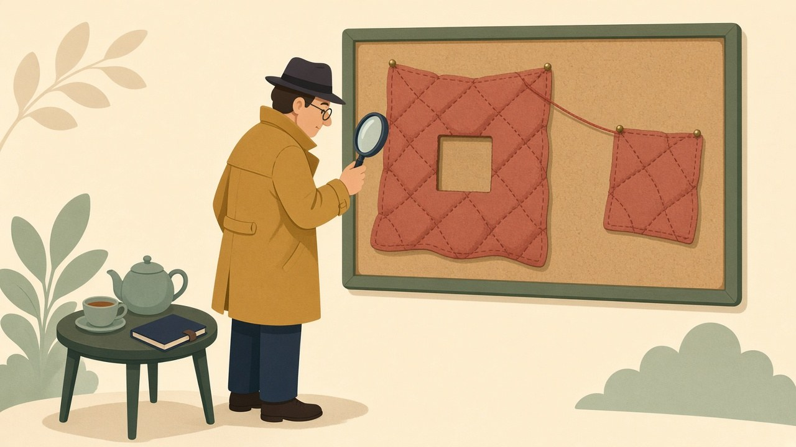

[Last week's CutMix experiment](/posts/cutmix-measured/) left a −3.08 on the table and an attribution question hanging. CutMix does two things at once: it *occludes* — a rectangular patch of the image is gone, replaced by foreign pixels — and it *softens the label* in proportion to the stolen area. At a 10-epoch budget the combination clearly hurt, and coming off [the mixup results](/posts/mixup-measured/), the label side looked like the obvious suspect: soft targets had just been caught deflating confidence and wrecking ECE across two techniques. The natural indictment writes itself — the occlusion is honest augmentation, the label arithmetic is the liability.

That's a testable accusation, because the two ingredients separate cleanly. Cutout is CutMix with the label left alone: cut the same box, fill it with zeros instead of another image's pixels, and keep training against the original one-hot target. I ran it two ways on the [usual recipe](/posts/sgd-vs-adam-fixed-budget/), five paired seeds each. The arm that matters scientifically — **cutout matched** — uses the *exact same box sampler* as last week's CutMix arm: `lam ~ Beta(1,1)`, same border clipping, logged erased area averaging 30% per step, identical to CutMix's swapped area. The second arm is the practitioner's reference: the classic fixed 16×16 Cutout patch (19% of a CIFAR image on average, after clipping). Baseline and CutMix comparisons are the same-seed runs from the last two posts.

## The verdict table

| arm | area touched | label | accuracy | Δ vs baseline (t) | conf | conf − acc | ECE | NLL |
|---|---|---|---|---|---|---|---|---|
| baseline | — | one-hot | 89.74 ±0.20 | — | 92.5 | +2.8 | 2.85 | 0.315 |
| cutmix p=1.0 | ~30% swapped | soft | 86.65 ±0.26 | −3.08 (t = −23.9) | 76.2 | −10.4 | 10.49 | 0.473 |
| **cutout matched** | ~30% zeroed | one-hot | 85.34 ±0.42 | **−4.40 (t = −18.7), 0/5** | 88.3 | **+3.0** | 3.09 | 0.436 |
| cutout 16×16 | ~19% zeroed | one-hot | 87.84 ±0.16 | −1.90 (t = −16.2), 0/5 | 90.8 | **+3.0** | 3.00 | 0.367 |

Read the matched arm against CutMix, because that's the trial. Same box distribution, same erased area, and the arm that kept its labels *honest-to-the-original* scored **1.31 points worse** (t = −9.07, zero wins in five) than the arm that confessed the occlusion to the loss function. The suspect I indicted was innocent. Worse than innocent — the soft label was compensating for the hole's damage, buying back a point and a third. Occlusion alone at this dose costs −4.40; CutMix's full package costs −3.08; the difference is what honest accounting is worth.

The mechanism reads straightforwardly once the numbers force you to look at it. When a `Beta(1,1)` box erases, say, 60% of a frog and the label still demands 100% confidence in *frog*, the loss is instructing the model to extract certainty from pixels that no longer contain it — on the worst draws, from an image that is mostly a black rectangle. That's not regularization; a meaningful fraction of the time it's [label noise](/posts/image-preprocessing-bugs-ranked/), manufactured on the fly. CutMix's area-proportional label is exactly the correction for that: supervision scaled to surviving evidence. One scope line on the attribution: the matched pair differs in fill content too (zeros vs. another image's pixels), so the +1.31 is the *joint* value of honest labels plus informative fill — I can't split those two with these arms. What the pair does settle is the sign question I came to court with: the damage lives in the hole, not in the label.

## The calibration panel, predicted from the other direction

The [obedience theory](/posts/mixup-measured/) made its name predicting *deflated* confidence from soft targets. Cutout is its mirror-image test: targets are pure one-hot, confidence requested = 100%, so the theory says these models should behave like the baseline — mildly overconfident by the usual ~3 points, ECE in the baseline's neighborhood — *no matter how much of the image is missing*. That's exactly what the panel shows: both Cutout arms sit at a +3.0 confidence gap and ECE ≈ 3.0, indistinguishable from the baseline's +2.8 and 2.85, while their raw confidences (88.3, 90.8) dropped only in lockstep with their accuracies. Train on hard labels and the calibration profile is inherited unchanged; train on soft ones and [confidence snaps to the target average](/posts/cutmix-measured/). Five arms of evidence across three techniques now, and no exceptions.

There's even a quiet dose-response hiding in the two Cutout arms: 19% erased costs −1.90, 30% erased costs −4.40 — the damage curve is steepening in the direction that hurts, the same superlinear shape the [EMA decay sweep](/posts/ema-decay-dose-response/) and the [subject-count curve](/posts/har-subjects-vs-hours/) traced on their own axes.

## Where the occlusion family stands at ten epochs

Stacking the three posts: every occlusion-or-blend augmentation I've now measured loses or ties at this budget — mixup α=0.2 was [the lone null](/posts/mixup-measured/) (and it's the arm that deletes *nothing*), while CutMix p=0.5 (−0.92), standard Cutout (−1.90), CutMix p=1.0 (−3.08), and matched Cutout (−4.40) line up almost perfectly by how much image they destroy per step. The ordering practitioners inherit from ImageNet leaderboards — CutMix over mixup over Cutout — is a long-schedule ranking of *benefits*; at a tenth of the schedule the same list reorders into a ranking of *harms*, by erased pixels. Scope lines as always: one dataset, one small model, one budget, and none of this contradicts what these techniques do at 200 epochs, where the regularization loan has time to pay interest instead of just principal. What survives any schedule is the trial's finding: if you're going to cut holes in your training images, the soft label isn't the price of CutMix — it's the refund. The folklore had the polarity backwards, and it took a zero-filled control arm to flip it.
