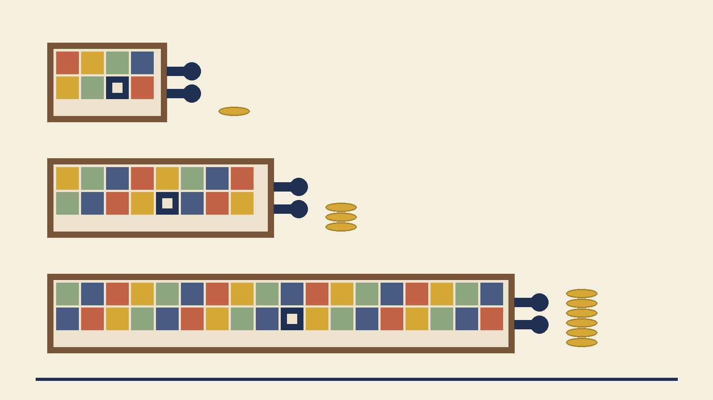

Every augmentation result on this blog has carried the same scope line: *one budget, 10 epochs against the technique's native 90 to 200, long-schedule regime deliberately unmeasured.* I wrote it under [mixup](/posts/mixup-measured/), under [CutMix](/posts/cutmix-measured/), under [Cutout](/posts/cutout-cutmix-decomposition/), and each time I offered the same explanation for the losses: a strong regularizer is a loan against training time, and a 10-epoch budget can't service it. That's a mechanism claim with a testable shape. If it's right, the deficit should shrink as the schedule lengthens, and at some budget the sign should flip. If it's wrong, CutMix just hurts on this setup and the loan story is a comfortable excuse.

So this is the repayment-schedule post. Same harness as the [CutMix measurement](/posts/cutmix-measured/): CIFAR-10, the adapted ResNet18, the [tuned Adam recipe](/posts/sgd-vs-adam-fixed-budget/) (lr 1e-3, weight decay 5e-4, cosine), five paired seeds. Two arms — plain baseline and always-on CutMix with `lam ~ Beta(1,1)`, the same box sampler and the same RNG draw order as the p=1.0 arm two weeks ago — trained at 20 and 40 epochs, with the cosine schedule stretched to fill each budget. The 10-epoch rows are the same-seed runs from the earlier posts. The calibration instruments ride along as usual: mean confidence of the predicted class, 15-bin ECE, NLL.

## The accuracy column: the loan gets repaid, on schedule

| budget | baseline acc | CutMix acc | CutMix − baseline (t), wins | baseline gain vs E10 | CutMix gain vs E10 |
|---|---|---|---|---|---|
| 10 | 89.74 ±0.20 | 86.65 ±0.26 | **−3.08** (t = −23.9), 0/5 | — | — |
| 20 | 91.94 ±0.19 | 90.85 ±0.21 | **−1.09** (t = −9.2), 0/5 | +2.21 (t = +13.8) | +4.20 (t = +32.8) |
| 40 | 92.72 ±0.10 | 92.83 ±0.12 | **+0.12** (t = +1.4), 4/5 | +2.98 (t = +28.3) | +6.18 (t = +75.3) |

The loan story survives, and it survives quantitatively. Doubling the budget cut the deficit from 3.08 to 1.09; doubling again brought CutMix to +0.12 — a number the pairing cannot distinguish from zero (t = 1.4), but a four-wins-in-five that sits on the right side of it. Parity at four times my standard budget, not yet a win. The gains column is the mechanism made visible: both arms improve with budget, but CutMix improves roughly twice as fast (+4.20 vs +2.21 at 20, +6.18 vs +2.98 at 40), because it started the race underfit and the baseline started the race nearly done. The baseline's own returns are already diminishing — +2.21 for the first doubling, +0.78 for the second — while CutMix still took +1.98 from the second doubling. Extrapolating that pair of curves to 80 epochs puts CutMix ahead by something like a point, which is exactly the regime where it earned its reputation; I haven't run it, and the extrapolation is the one sentence in this post without a t-statistic attached.

One more thing the seed columns say. The spread *shrank* with budget on both arms — baseline ±0.20 → ±0.19 → ±0.10, CutMix ±0.26 → ±0.21 → ±0.12 — which is the [same stabilizing effect](/posts/stacking-the-months-wins/) a longer cosine tail has shown before on this harness. At 40 epochs a 0.12-point difference comes with a 0.19 paired standard deviation; at 10 epochs the same difference would have been invisible.

## The confidence column: the theory stops being obeyed

This is the part I didn't predict, and the record shows I was set up to predict the opposite. The [obedience theory](/posts/mixup-measured/) says a soft-target model's mean confidence converges to the average confidence its targets request — for this CutMix arm, `E[max(lam_eff, 1 − lam_eff)]` under the clipped box sampler, logged at 73.1. That number is a property of the sampler, not of training, so the theory's natural extension is that CutMix's confidence should sit near 76 at every budget while the baseline's climbs. It had just [predicted four arms within five points](/posts/cutmix-measured/) and then [predicted Cutout's mirror image](/posts/cutout-cutmix-decomposition/). I was ready to collect a fifth.

| budget | baseline conf (conf − acc) | CutMix conf, requested 73.1 (conf − acc) | baseline ECE | CutMix ECE | baseline NLL | CutMix NLL |
|---|---|---|---|---|---|---|
| 10 | 92.5 (+2.8) | **76.2** (−10.4) | 2.85 | 10.49 | 0.315 | 0.473 |
| 20 | 95.5 (+3.6) | **80.5** (−10.4) | 3.64 | 10.34 | 0.266 | 0.359 |
| 40 | 96.7 (+4.0) | **86.1** (−6.7) | 3.96 | 6.74 | 0.274 | 0.277 |

The request never changed and the delivery drifted: 76.2, 80.5, 86.1. By 40 epochs the model reports confidence thirteen points above what its labels, on average, asked for. The obedience arithmetic was a 10-epoch phenomenon, and in hindsight the reason is in what obedience *requires*. The cross-entropy against an area-proportional target has an exact minimizer: output `lam_eff` on the dominant class and `1 − lam_eff` on the guest, for that specific patched image. A model that can't yet tell a patched image from a clean one can only honor that target in aggregate — so its confidence on clean test images lands at the target's average, and the theory looks like a law. A model with budget to spare learns the distinction: a foreign rectangle is a visible feature, and *its absence* is one too. Once the network can see that a test image contains no patch, nothing in its training signal asks it to hedge, and confidence on clean inputs starts climbing toward the baseline's. The soft target stops being a confidence ceiling and becomes what it was always meant to be — a per-example instruction the model follows more precisely the better it fits.

That reading makes a prediction I can check against the table: the drift should accelerate rather than saturate, because the patch-detection skill compounds with fit. It did — +4.3 points from the first doubling, +5.6 from the second. And it reframes the whole ECE story. At 10 and 20 epochs CutMix's ECE sat above 10 because the confidence haircut massively overshot a mildly overconfident baseline; at 40 the haircut has shrunk toward the 4-point overconfidence the baseline actually carries, and ECE fell to 6.74 while NLL converged on the baseline's (0.277 vs 0.274). CutMix's calibration didn't improve because the technique calibrates. It improved because the model stopped doing what the labels said.

Which also means my [earlier framing](/posts/cutmix-measured/) needs a scope line it didn't have: "you can write down your mean confidence before training" is true at budgets where the model is still underfitting the augmentation. At budgets where CutMix starts paying for itself in accuracy, the confidence column is back to being a training outcome. If you need honest probabilities from a long-schedule CutMix model, nothing here changes the ranking — [one fitted temperature](/posts/temperature-scaling-measured/) afterwards remains the tool, and it has less to undo at 40 epochs than at 10.

Scope lines: one dataset, one small model, one optimizer recipe, one augmentation at one dose, and three budgets that stop at 40 — the sign flip is a 4/5 near-null, not a measured win, and the 80-epoch point where I'd expect a real one is unrun. The baseline's confidence trend (92.5 → 95.5 → 96.7 on accuracy that moved three points) is its own small finding, consistent with the [label smoothing series](/posts/label-smoothing-dose-response/): the longer this recipe trains, the more overconfident it gets, and the bigger the correction any soft-target technique would need to match. What I'd defend from today: the loan metaphor is now a measured repayment curve, roughly a halving of the deficit per doubling of budget until parity; and the obedience theory is demoted from law to regime — exact while the model underfits, eroding as it fits, by a drift that grows with every doubling.
