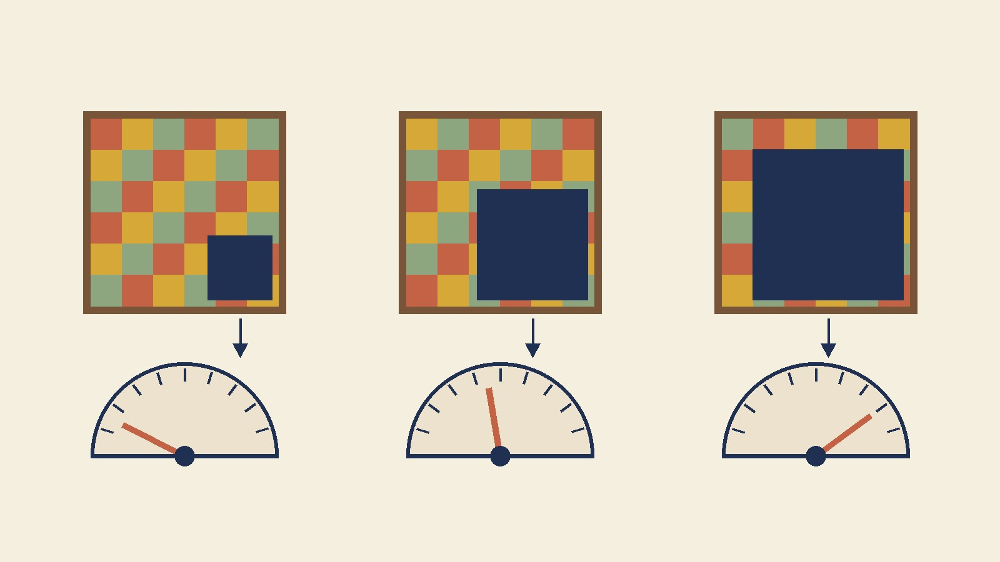

[Yesterday's budget sweep](/posts/cutmix-budget-crossover/) ended with a mechanism I liked more than I had earned. CutMix's mean confidence on clean test images had drifted from 76 to 86 as the schedule went from 10 to 40 epochs while the confidence its labels requested stayed fixed at 73, and I explained the drift like this: a model with budget to spare learns that a foreign rectangle is a visible feature *and that its absence is one too*; once it can see a test image has no patch, nothing asks it to hedge, so clean-image confidence climbs toward the baseline's. That story makes two predictions I didn't test. On *patched* inputs the model should follow its area-proportional label more precisely as budget grows — slope toward 1, per-example error toward 0. And the clean-image hedge should disappear *faster* than the patched-image shortfall, because the model is supposedly treating the two cases differently. Today I ran the probe.

The instrument is simple. Every model — baseline and always-on CutMix, 10 and 40 epochs, five paired seeds each, same [tuned Adam recipe](/posts/sgd-vs-adam-fixed-budget/) and the same box sampler as the last three posts — is evaluated on a *fixed* patched copy of the CIFAR-10 test set: each of the 10,000 images gets its own `lam ~ Beta(1,1)` box filled from another test image, with the probe's RNG seeded once so all twenty models see identical pixels. For each image I know what CutMix's label would have *requested*: `max(lam_eff, 1 − lam_eff)` on the class owning the larger region. I compare it to what the model *delivers* — the probability it assigns to that dominant class — and summarize with the least-squares slope of delivered on requested, the mean absolute obedience error, the delivered confidence per requested-confidence bin, and how often the argmax lands on the dominant class. Same-class pairs (about 10%) carry no information and are dropped, leaving 8,968 probes per model. A first version of this probe used one box per batch of 512 and produced bins too lumpy to read; everything below is the per-image version.

## The obedience panel

| model | slope (req → delivered) | obedience error | delivered conf at requested 55 / 65 / 75 / 85 / 95 | dominant-class hit rate | clean conf |
|---|---|---|---|---|---|
| baseline E10 | 1.16 | 31.7 | 39.5 / 49.7 / 64.1 / 74.8 / 83.8 | 64.6 | 92.6 |
| CutMix E10 | 0.83 | 25.2 | 37.6 / 46.7 / 55.6 / 63.6 / 70.0 | 70.3 | 75.8 |
| baseline E40 | 1.22 | 32.2 | 41.9 / 53.5 / 69.3 / 80.1 / 88.5 | 66.9 | 96.7 |
| CutMix E40 | **0.95** | **18.5** | 44.6 / 55.2 / 66.2 / 74.6 / 81.4 | **77.6** | 86.3 |

Paired across seeds, CutMix E40 − E10: slope +0.120 (t = +23.4), obedience error −6.68 (t = −48.0), dominant-class hits +7.34 (t = +34.4), all five of five. Baseline E40 − E10: slope +0.062, obedience error **+0.48** (t = +2.8), hits +2.30.

## The half that held

The CutMix model learns the patch. At 10 epochs its response to patch size is flatter than the label's (slope 0.83); at 40 it's within five percent of proportional (0.95), and the per-example obedience error dropped from 25 to 18.5 points. It also got markedly better at the task the probe implicitly poses — *which of these two objects owns more of this image?* — landing on the dominant class 77.6% of the time against the baseline's 66.9%, a gap that widened from 5.7 points at E10 to 10.7 at E40. The baseline, which never saw a patch in training, learned none of this: its obedience error went slightly *up* with budget, and its slope went further *past* proportional, from 1.16 to 1.22. That steepness is worth reading on its own. A baseline handed an image that is 55% frog and 45% truck gives frog 41.9 — it flips to the intruder nearly half the time — while an image that's 95% frog gets 88.5, essentially its clean-image confidence. The baseline treats a patch as either an invisible blemish or a replacement, with little in between. CutMix's whole curriculum is the in-between, and by 40 epochs the model has it: 44.6 at 55, 81.4 at 95, a line of slope 0.95.

So the premise of yesterday's story is confirmed with a t-statistic in the twenties: budget buys per-example obedience, and the model that gets it also gets the occlusion skill that presumably [pays for CutMix's accuracy](/posts/cutmix-budget-crossover/) on long schedules.

## The half that failed

Now look at the bins again, as *deficits* from the request. CutMix E10 delivers 17 to 25 points under what its label asked at every patch size. CutMix E40 delivers 10.4, 9.8, 8.8, 10.4, 13.6 under — call it ten points, nearly flat across the range. And the clean-image gap between CutMix and the baseline is 16.8 points at E10 and **10.4 at E40**. That's the number the story said should be shrinking *faster* than the patched shortfall, because clean images were supposedly the case the model had learned to exempt from hedging. It isn't. The clean-image hedge is the same size as the patched-image hedge at both budgets, and the two shrank together, by about seven points each, from E10 to E40.

That kills the mechanism as I stated it. The model is not detecting "no patch here" and dropping its guard; if it were, clean inputs would sit near the baseline's 96.7 while patched inputs tracked their labels. What the data describe instead is a **uniform confidence tax**: CutMix training deflates the model's probability on its chosen class by a roughly constant amount regardless of whether the input is patched, and the tax rate falls as the model fits — about 17 to 20 points at 10 epochs, about 10 at 40. Underneath that tax, the *shape* of the response becomes proportional (that's the slope going to 0.95); on top of it, the whole curve sits shifted down by the tax. Yesterday's confidence drift, 76 → 86 on clean images, was the tax rate falling, not a targeting skill arriving — the same ten-point relief shows up in every row of the patched table.

Why would a soft-target model carry a flat tax at all? The [cross-entropy minimizer](/posts/mixup-measured/) for an area-proportional target is the target itself, per example, and an exact fit would mean zero tax. A model that *can't* yet fit those per-example targets — too little budget, too much variety in where the boxes land — reduces its loss by hedging globally, because overconfident misses on soft targets are expensive everywhere. As fit improves the global hedge is traded for the specific one, and the residual global hedge is what we measure as the tax. The prediction that follows is checkable and I haven't checked it: at 80 or 160 epochs the tax should keep falling toward zero on patched *and* clean inputs together, and CutMix's clean-image confidence should approach — never exceed — the baseline's. If instead the clean-image gap closes while the patched deficit stays, yesterday's story was right after all and today's probe just caught it mid-transition. Either outcome is a measurement away.

## A replication, for free

Training the 40-epoch arms again to probe them also reran [yesterday's](/posts/cutmix-budget-crossover/) accuracy comparison on the same seeds. Yesterday: CutMix − baseline **+0.12** (t = +1.4, 4/5). Today: **+0.34** (t = +4.2, 5/5), with the 10-epoch rerun at −3.31 against yesterday's −3.08. Nothing in the code changed between the two except the probe; `cudnn.benchmark` picks kernels nondeterministically, so even same-seed runs [aren't bit-identical on this harness](/posts/pytorch-same-seed-different-model/). I'd now describe the 40-epoch CutMix effect as somewhere between +0.1 and +0.3 — small, probably real, and still short of the point-sized win the gain curves predict at 80.

Scope lines: one dataset, one small model, one augmentation at one dose, two budgets, and a probe built from CutMix's own sampler — a different box distribution would shift every number in the bins. What survives: the obedience theory's per-example form is confirmed to be *learnable with budget*, and the clean-image confidence drift I over-explained yesterday is better described as a uniform hedge decaying with fit. The practical line hasn't moved: if you need honest probabilities from a CutMix model, [one fitted temperature](/posts/temperature-scaling-measured/) corrects a flat tax almost perfectly — and a flat tax is exactly what today's panel says this is.
