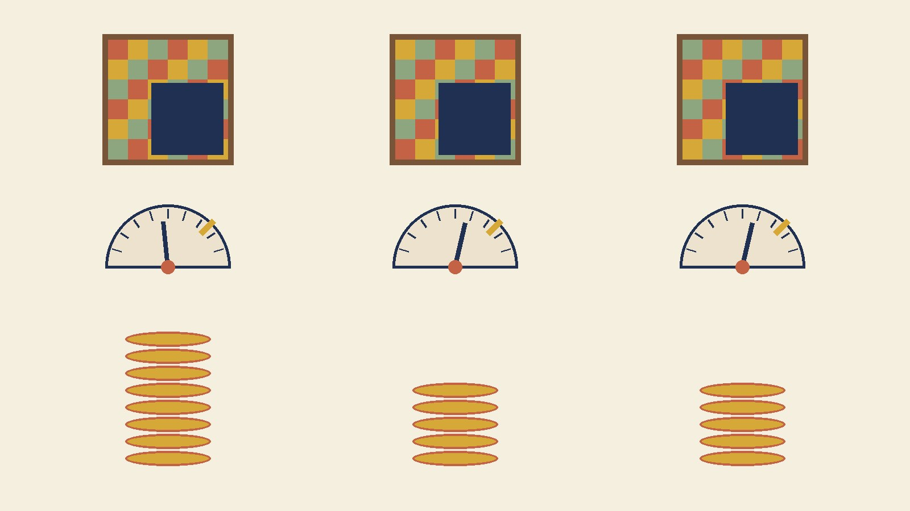

The CutMix arc has been running on two predictions. From the [budget sweep](/posts/cutmix-budget-crossover/): the accuracy gap, −3.1 at 10 epochs and +0.1 at 40, should become a point-sized win by 80. From the [obedience probe](/posts/cutmix-patch-obedience-probe/) and [this morning's temperature post](/posts/cutmix-temperature-tax/): the model's roughly ten-point confidence shortfall — present on patched inputs and clean ones alike, a *uniform tax* — was a residue of under-fitting and should keep falling toward zero as budget grew, on both input types together. Both predictions needed the same experiment, so I ran it: baseline and always-on CutMix at 80 epochs, five paired seeds, same [tuned Adam recipe](/posts/sgd-vs-adam-fixed-budget/) with the cosine schedule stretched to the new length, each model pushed through the clean test set and through the fixed per-image patched copy that the last two posts used. Ten models, about ten minutes each, and three budgets to read across.

## Three budgets, one table

| budget | accuracy baseline / CutMix (paired Δ) | clean conf baseline / CutMix (gap) | CutMix obedience error | CutMix slope | CutMix deficit at requested 55 / 65 / 75 / 85 / 95 | dominant-class hits CutMix / baseline |
|---|---|---|---|---|---|---|
| 10 | 90.02 / 86.71 (−3.31, t = −17.5, 0/5) | 92.6 / 75.8 (**16.8**) | 25.2 | 0.83 | −17.4 / −18.3 / −19.4 / −21.4 / −25.0 | 70.3 / 64.6 |
| 40 | 92.73 / 93.07 (+0.34, t = +4.2, 5/5) | 96.7 / 86.3 (**10.4**) | 18.5 | 0.95 | −10.4 / −9.8 / −8.8 / −10.4 / −13.6 | 77.6 / 66.9 |
| 80 | 93.04 / 93.80 (**+0.75**, t = +7.0, 5/5) | 97.2 / 87.7 (**9.6**) | 16.4 | 0.95 | −9.6 / −9.0 / −7.8 / −9.6 / −12.5 | 79.7 / 66.6 |

Paired by seed across the doubling from 40 to 80, CutMix: accuracy +0.73 (t = +8.3), obedience error −2.04 (t = −25.1), dominant-class hits +2.10 (t = +13.9), slope +0.002 (t = +0.4), clean confidence +1.38 (t = +3.7), every per-bin deficit about +0.9 (t ≈ 2). The clean-image gap shrank by 6.44 points from 10 to 40 epochs (t = −19.3) and by 0.82 from 40 to 80 (t = −2.7).

## The prediction that landed

The accuracy story from the budget sweep is now the cleanest result in the arc. Three budgets, three paired comparisons, and the gap walks from a three-point loss through a near-tie to a clear win: −3.31, +0.34, +0.75, with the 80-epoch win carried by all five seeds at t = 7. The baseline is also saturating in a way the CutMix model is not — its own 40-to-80 gain was +0.32 against CutMix's +0.73 — so the gap should keep opening a little further. I had written that the gain curves predicted a point-sized win at 80 and it came in at three quarters of a point; close enough to call the prediction confirmed in direction and roughly in size, with the usual [same-seed noise](/posts/pytorch-same-seed-different-model/) of a couple of tenths on either side. The loan metaphor survives intact: CutMix borrows accuracy early and repays with interest once the model has the budget to learn the patch, and the occlusion skill the probe measures — picking the class that owns more of a patched image — kept climbing right alongside, 70 → 78 → 80 percent against a baseline stuck at 67.

## The prediction that didn't

Now the tax. The mechanism I offered yesterday, and refined this morning, was a *fit* story: a model that cannot yet match its area-proportional targets hedges globally, and as fit improves the global hedge is traded for the specific one and the residue decays toward zero. The data had supported it with one data point — the tax fell by about seven points between 10 and 40 epochs while obedience improved — which is exactly one data point too few to distinguish "decaying" from "falling to a floor." The second doubling settles it. Fit kept improving, unambiguously: obedience error down another two points at t = 25, dominant-class hits up two, accuracy up 0.7. The tax barely moved: the clean-image gap went 10.4 to 9.6, and the patched deficits went from about ten to about nine in every bin. Same doubling of budget, an eighth of the relief. If the tax were a function of fit it would have followed the fit; it didn't, so it isn't. What I called a residue decaying with training is a floor the model reached by 40 epochs and has not left.

The shape of the floor is worth stating plainly, because it constrains the next explanation. At 80 epochs the CutMix model delivers a clean-image confidence of 87.7 on an accuracy of 93.8 — six points underconfident, in the same direction as the [label-smoothed models](/posts/temperature-scaling-measured/) earlier in this blog and for what is probably the same reason. On patched images with a dominant region of 90 percent or more, where the label asks for 95, it delivers 82.5. On the baseline's side nothing moved either: 97.2 confidence on 93.0 accuracy, ECE drifting up from 4.0 to 4.25, slope still past proportional. Both models have settled into their respective confidence habits, and the budget axis no longer reaches them.

## What sets a floor, if not fit

A floor set by something other than budget points at the one thing in this arc I haven't varied: the dose. Always-on CutMix means the model trains on a patched image with a soft label every single step. It never sees an unpatched image paired with a hard label; the closest it comes is the few percent of boxes small enough to request a target above 95, and on exactly those images it delivers 82. A model whose every training target is a mixture has no example from which to learn what full certainty looks like, and nothing in the loss asks it to extrapolate past the most confident target it regularly meets. That is a dose story, not a budget story, and it makes a prediction that ten more runs can check: at CutMix probability 0.5 — half the batches clean with hard labels, half patched — the clean-image confidence gap at 40 epochs should collapse to a few points, and the per-bin deficit on patched inputs should narrow with it, because the model now has a reference for certainty. If instead the gap stays near ten at half dose, the floor is a property of soft-target training as such and I will need a third story. Either way the ten-point number is not going to be trained away, and this morning's practical line stands unchanged: on clean inputs one temperature refunds it in full, on patched inputs nothing does.

Scope lines: one dataset, one small model, one augmentation at one dose, three budgets up to 80 epochs, five paired seeds, and a patched probe built from CutMix's own box sampler. What survives from the arc so far: budget buys CutMix its accuracy win and its per-example obedience, both now confirmed across a doubling; budget does not buy back its confidence, which plateaus around ten points under the baseline by 40 epochs and is best read as a ceiling set by what the labels ever asked for.
