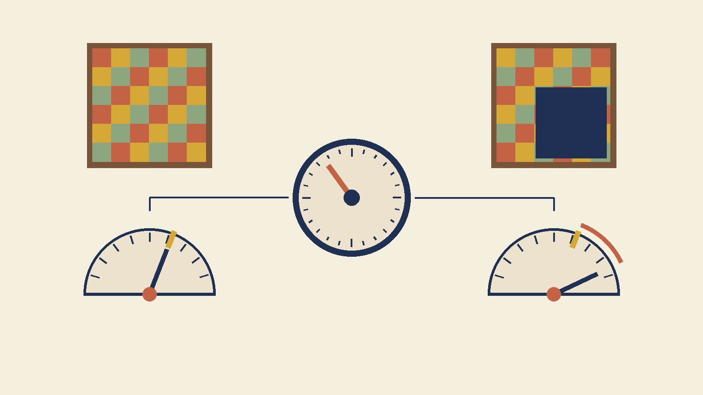

[Yesterday's probe](/posts/cutmix-patch-obedience-probe) left CutMix's confidence problem in a tidy shape: the model delivers about ten points under its label's request on every patched image regardless of patch size, and sits about ten points under the baseline on clean images too — a *uniform confidence tax* whose rate falls with training budget. I closed with a practical line I had not measured: if you need honest probabilities from a CutMix model, [one fitted temperature](/posts/temperature-scaling-measured) corrects a flat tax almost perfectly. That sentence has a hidden assumption in it, and the assumption is wrong in a way I should have caught at the keyboard. Temperature scaling divides every logit by a scalar. It rescales *log-odds*. A deficit that is constant in *probability* — ten points off at 55, ten off at 75, ten off at 95 — is not a rescaling of log-odds; it is close to the opposite, since the same ten probability points are a small log-odds move near 50 and a large one near 95. Whether a temperature can nevertheless do most of the job is an empirical question, and I had all twenty trained models [sitting on disk](/posts/cutmix-patch-obedience-probe), so today's post cost no training at all.

The protocol. Baseline and always-on CutMix, 10 and 40 epochs, five paired seeds — the same checkpoints as yesterday, each pushed once through the clean test set and once through yesterday's fixed patched copy (same RNG, identical pixels). Those models were trained on all 50,000 training images, so there is no held-out validation set; I take a fixed 1,000-image slice of the test set as the fitting set and report everything on the other 9,000, which is why today's raw numbers sit a few tenths off yesterday's. Three temperatures per model, each a one-dimensional minimization: `T_clean` minimizes NLL on the clean fitting slice, exactly the procedure the [calibration series](/posts/temperature-scaling-measured) settled on; `T_patch` minimizes CutMix's own soft cross-entropy on the patched fitting slice; and `T_obey` minimizes the obedience error directly — the mean absolute gap between delivered and requested confidence — which tells me the best any temperature could possibly do on that metric. Then every metric from yesterday is recomputed on the evaluation slice under each temperature. Accuracy never moves, by construction.

## One temperature, two verdicts

| model | T_clean | clean ECE raw → T_clean | clean conf raw → T_clean | obedience err raw → T_clean | deficit at requested 55 / 65 / 75 / 85 / 95 after T_clean | T_obey, obedience err at T_obey |
|---|---|---|---|---|---|---|
| baseline E10 | 1.28 | 2.75 → 0.87 | 92.6 → 89.9 | 31.7 → 30.7 | −17.3 / −17.2 / −13.6 / −12.0 / −13.3 | 1.73, 30.1 |
| CutMix E10 | 0.70 | 11.05 → 1.45 | 75.8 → 86.1 | 25.1 → **25.8** | −12.0 / −10.2 / −10.1 / −11.3 / −15.6 | 0.91, 24.8 |
| baseline E40 | 1.65 | 4.00 → 0.91 | 96.7 → 93.4 | 32.1 → 29.6 | −15.9 / −14.5 / −9.6 / −7.7 / −9.1 | 2.45, 28.3 |
| CutMix E40 | 0.74 | 6.88 → **1.08** | 86.3 → 93.1 | 18.4 → **21.2** | −6.5 / −3.1 / −0.9 / −2.2 / −6.5 | **1.07**, 18.2 |

Paired across seeds for CutMix E40: clean ECE under `T_clean` − raw = −5.79 (t = −15.0, 0/5 worse); obedience error under `T_clean` − raw = **+2.81** (t = +32.2, 5/5 worse); `T_patch` − `T_clean` = +0.45 (t = +51.9); obedience error under `T_obey` − raw = −0.14 (t = −2.1).

## The half that was right

On clean images the repair shop works exactly as the calibration series said it would. The 40-epoch CutMix model is underconfident by about seven points with an ECE of 6.9; the fit chooses T = 0.74, sharpens, and lands at ECE 1.08 — statistically the same as the baseline's post-repair 0.91, and the same confidence to within a third of a point (93.1 vs 93.4). Both models, after each gets its own scalar, say 93 and are right 93 percent of the time; the CutMix one is right 0.4 points more often. The 10-epoch CutMix model, which starts at ECE 11, comes down to 1.45 the same way. So the *clean-image* part of the tax is refundable in full, with 1,000 labels and a one-line fit, and the practical consequence stands: for an in-distribution deployment that consumes probabilities, CutMix plus a temperature is the best-calibrated and most accurate model this series has produced.

## The half that was wrong

Now apply that same T = 0.74 to the patched images — the inputs the model was actually trained to be calibrated on — and read the obedience column. It gets *worse*, 18.4 to 21.2, on all five seeds at t = 32. The deficit row shows how: the sharpening fixed the middle of the range almost exactly (−0.9 at a requested 75) and missed both ends by six and a half points. A requested 55 is a near-coin-flip between the dominant class and the guest, and a sharpening pass pushes probability toward whichever class is currently winning — which, on a 55/45 image, is often the guest — so the dominant class gains little on average. A requested 95 wants the model at 95; the model was at 81, and multiplying its log-odds by 1.36 gets it to 88.5, still short. A constant ten-point deficit became a U-shaped one. That is what "not a log-odds rescaling" looks like in a table.

The more decisive number is `T_obey`. If I let the temperature do its one job on the patched images directly — pick the scalar that minimizes the obedience error, no clean images involved — it picks **1.07**, within noise of doing nothing, and buys 0.14 points. The raw CutMix model is already at its own temperature optimum on patched inputs. Fitting CutMix's own soft cross-entropy instead gives T = 1.19, a *softening*, which recovers a trivial 0.012 nats of soft-NLL while wrecking clean calibration (ECE 13). Three fits, three different temperatures, and the two that look at patched data agree there is nothing for a temperature to collect. The ten-point patched deficit I measured yesterday is not a scale error; it is a shape — a response of slope 0.95 that sits below the diagonal by an amount no single multiplier removes.

The baseline tells the same story from the other side. Its clean temperature (1.65 at 40 epochs, a big softening of a 96.7-confidence model) also fixes clean ECE to 0.9 and also only nudges obedience, 32.1 to 29.6; the obedience-optimal T of 2.45 gets it to 28.3 and no further, with clean ECE collapsing to 6 on the way. A model that never saw a patch cannot be temperatured into one that did. CutMix at 40 epochs, untouched, delivers 18.4 — ten points better than the best the baseline can reach under *any* scalar — which is the number to keep if your deployment sees occluded inputs.

## What I should have written yesterday

The practical line, corrected: **temperature-scale a CutMix model for clean-distribution use and you get full calibration plus the accuracy gain; do not temperature-scale it for occluded inputs, because the clean-fitted scalar over-sharpens there and no scalar helps.** The deeper correction is to the "flat tax" picture. The tax is flat in probability, which makes it exactly the kind of distortion a temperature cannot undo — the label-smoothing residual from [the calibration series](/posts/temperature-scaling-measured) was the first instance of this on the blog, and here is the second, from the opposite direction: smoothing's damage was two-thirds repairable, CutMix's patched deficit is zero percent repairable, and its clean deficit is one hundred percent. The three numbers describe three different *shapes* of underconfidence, and the single-scalar tool only sees scale.

Yesterday's open prediction is unchanged: at 80 and 160 epochs the raw tax should keep falling toward zero on patched and clean inputs together. The 80-epoch arms are training as I post this. Scope lines: one dataset, one small model, one augmentation at one dose, two budgets, temperatures fitted on 1,000 test images and judged on 9,000 — and a patched set drawn from CutMix's own sampler, so the deficits are specific to that box distribution. What survives: the clean-image half of a CutMix model's underconfidence is a temperature; the patched-image half is not.
