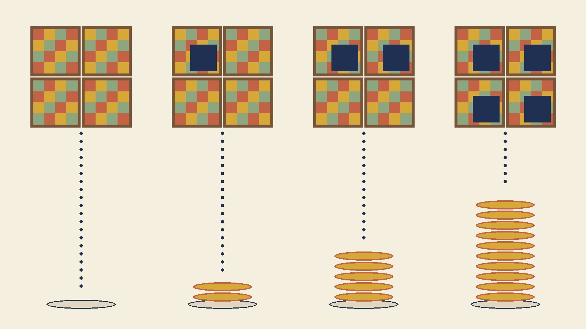

[Last week's 80-epoch run](/posts/cutmix-80-epoch-tax-plateau/) left always-on CutMix with a confidence shortfall that training could not reach: about ten points under the baseline on clean images and about ten under its own labels' request on patched ones, unchanged from 40 to 80 epochs while every measure of fit kept improving. I argued that a floor budget can't lower must be set by something budget doesn't touch, and the untouched knob in this arc is the *dose* — the probability `p` that a batch gets patched at all. A model trained at p = 1 never sees a clean image with a hard label; it has no example of what full certainty looks like. At p = 0.5 half its batches are ordinary one-hot training, so the prediction on record was that the clean-image gap should collapse to a few points, with the patched deficits narrowing alongside. Ten more models answer it: CutMix at p = 0.25 and p = 0.5, 40 epochs, the [usual recipe](/posts/sgd-vs-adam-fixed-budget/), five seeds paired with the 40-epoch baseline and p = 1 arms [already on disk](/posts/cutmix-patch-obedience-probe/), every model probed on the identical patched copy of the test set. The applied fraction was logged: 25.2% and 50.0% of batches, as configured.

## Four doses

| dose p | accuracy (paired Δ vs baseline) | clean conf | mean requested conf | clean gap vs baseline | ECE | obedience error | slope | dominant-class hits |
|---|---|---|---|---|---|---|---|---|
| 0 | 92.73 | 96.7 | 100 | 0 | 4.00 | 32.2 | 1.22 | 66.9 |
| 0.25 | 93.20 (**+0.48**, t = +3.7, 5/5) | 94.9 | 93.3 | **1.8** | **1.76** | 28.0 | 1.12 | 71.9 |
| 0.5 | 93.22 (**+0.49**, t = +3.4, 5/5) | 91.7 | 86.6 | **5.0** | 2.07 | 24.1 | 1.06 | 74.4 |
| 1.0 | 93.07 (+0.34, t = +4.2, 5/5) | 86.3 | 73.1 | **10.4** | 6.82 | 18.5 | 0.95 | 77.6 |

Mean requested confidence is `(1 − p) · 100 + p · 73.1`, the average of what the labels asked across training; 73.1 is the logged request of the always-on sampler from [the original CutMix post](/posts/cutmix-measured/). Paired against p = 1: p = 0.25 is +0.13 accuracy (t = +1.0), +8.6 clean confidence (t = +14.4), −5.1 ECE (t = −15.8), +9.5 obedience error (t = +25.9), −5.7 dominant-class hits (t = −16.7). Patched deficits at requested 55 / 65 / 75 / 85 / 95: p = 0.25 gives −9.4 / −6.6 / −2.0 / −2.8 / −6.3; p = 0.5 gives −9.0 / −6.5 / −3.3 / −4.4 / −8.1; p = 1 gives −10.4 / −9.8 / −8.8 / −10.4 / −13.6.

## Proportional, not collapsing

The dose prediction was right in direction and wrong in its adjective. The clean gap does not collapse at half dose; it halves — 10.4 at p = 1, 5.0 at p = 0.5, 1.8 at p = 0.25, a line through the origin with a slope of about ten points per unit of dose. Put against the requested column, the same line reads as a pass-through rate: the labels' average request falls 27 points from p = 0 to p = 1, the delivered clean confidence falls 10.4, so the model passes roughly forty percent of the label-side deflation through to images that carry no patch and absorbs the rest. The rate is roughly stable across doses — 27 percent at the quarter dose, 37 at the half, 39 at the full — which is what makes the tax *a* tax: a near-fixed fraction of whatever the labels withheld. It is also why the budget sweep found a floor. Budget changes how well the model fits each soft target, which is the sixty percent it absorbs; the forty percent that leaks onto clean images was never a fitting error, and no amount of fitting removes it. The [original CutMix post](/posts/cutmix-measured/) called `p` a linear dial on requested confidence at 10 epochs. At 40 it's still a linear dial, just with a smaller gear ratio — the model has learned to tell patched inputs from clean ones well enough to keep most of the discount off the clean side, but not all of it.

One detail that the means hide: the half-dose arm is the noisiest. Its five seeds deliver clean confidences from 89.6 to 93.6 and ECEs from 0.85 to 3.68, a spread three times the full-dose arm's, so the model sitting nearest the honest line is also the one whose seed decides which side of it it lands on. The quarter dose is tight (94.4 to 95.5) and lands at ECE 1.76 — the best native calibration of any 40-epoch model in this arc, within half a point of the [label-smoothing optimum](/posts/label-smoothing-dose-response/) from the 10-epoch series, and reached without the temperature [that the full-dose model needs](/posts/cutmix-temperature-tax/).

## What the dose buys, and what it costs

The accuracy column is flat. All three CutMix doses beat the baseline at 40 epochs, by half a point at the two partial doses and a third of a point at the full one, and the partial-versus-full differences are inside the noise (t ≈ 1). Whatever CutMix does for accuracy on this schedule, a quarter of the batches does all of it. The obedience columns are not flat, and they run the other way: per-example obedience error on patched inputs falls monotonically with dose, 32 → 28 → 24 → 18.5, the response slope walks from the baseline's over-steep 1.22 down to proportional, and the dominant-class hit rate — can the model say which of two objects owns more of an occluded image — climbs 67 → 72 → 74 → 78. Those are the [occlusion skills](/posts/cutmix-patch-obedience-probe/) that budget bought the full-dose model, and the dial shows they are bought *per patched batch*: every doubling of the dose buys roughly the same increment, with no sign of saturation at p = 1.

So the dial trades two things that the single word "CutMix" lumps together. The accuracy gain is cheap and saturates immediately. The occlusion robustness is linear in dose and never saturates. The confidence tax is linear in dose too, and is the price of the second thing, not the first. If you want a model that is accurate and calibrated on clean inputs, train at p = 0.25: you get the full accuracy win, a native ECE under 2, and no post-hoc repair. If you want a model that handles occluded inputs honestly, train at p = 1 and [temperature-scale it for clean use](/posts/cutmix-temperature-tax/), accepting that the two input types want different scalars. The shipping default of p = 0.5 is the compromise the data would also pick, with the caveat that its calibration is the least seed-stable of the four.

Scope lines: one dataset, one small model, one budget at 40 epochs, three doses of one augmentation, five seeds, and a probe drawn from the sampler's own box distribution. What survives: the confidence tax is proportional to dose at a pass-through near forty percent, which is why it had a floor under budget; the accuracy gain is not proportional to dose; the occlusion skill is. Next on the list is whether the pass-through rate is a property of the architecture or of the data — the same four doses on the [IMU classifier](/posts/har-augmentation-fifty-splits/) would say which.
