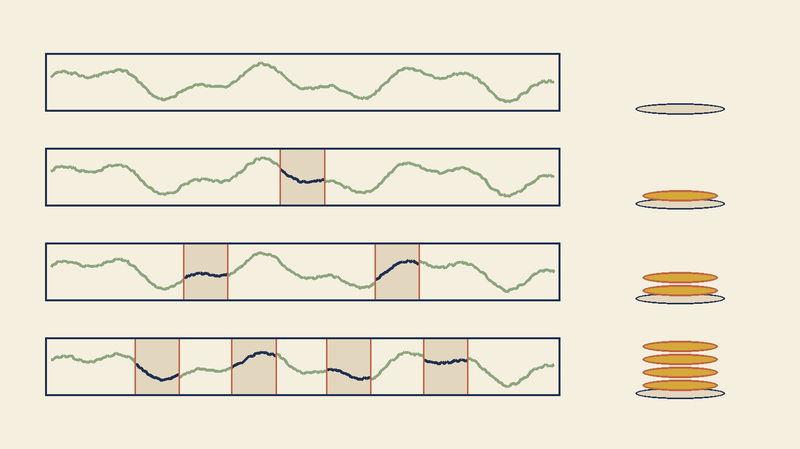

[Yesterday's dose sweep](/posts/cutmix-dose-tax/) closed the CutMix budget question on CIFAR-10: the confidence tax that always-on CutMix carries is proportional to how often you apply it, about ten points per unit of dose, and reads as a pass-through rate near forty percent of whatever the soft labels withheld on average. It also ended with the obvious next question — is forty percent a property of CutMix, or of the model and data it was measured on? — and named the cheapest place to ask it: the [IMU activity classifier](/posts/har-augmentation-fifty-splits/), whose training runs take three seconds and whose evaluation protocol already comes with fifty paired subject splits. So: the same four doses, 0 / 0.25 / 0.5 / 1, on UCI HAR with the usual recipe (the small 1-D CNN, Adam 1e-3, cosine, 15 epochs, batch 128, nine held-out subjects per split), fifty splits, 200 training runs, eight minutes of GPU. CutMix in one dimension splices a contiguous time segment from a random batch partner into each window, segment length `(1 − λ)·T` with `λ ~ Beta(1, 1)`, soft label by the actual spliced share, applied to a batch with probability `p` by the same gate as every [CutMix post](/posts/cutmix-measured/). The probe is the [patched-input probe](/posts/cutmix-patch-obedience-probe/) in 1-D: every held-out window gets its own segment from a fixed RNG, so all four doses in a split are scored on the identical spliced set, and the sampler's mean requested confidence comes out at 71.3, within two points of the image sampler's 73.1.

## Four doses, fifty splits

| dose p | accuracy (paired Δ vs baseline) | clean conf | conf − acc | clean gap vs baseline | pass-through | ECE | obedience error | slope | dominant-class hits |
|---|---|---|---|---|---|---|---|---|---|
| 0 | 92.65 | 95.2 | **+2.6** | 0 | — | 4.06 | 21.3 | 0.86 | 83.6 |
| 0.25 | 92.79 (+0.15, t = +2.5, 32/50) | 93.8 | +1.0 | **1.4** | **19.5%** | 3.39 | 16.4 | 0.95 | 85.4 |
| 0.5 | 92.79 (+0.14, t = +2.0, 28/50) | 93.0 | +0.3 | **2.2** | **15.3%** | 3.23 | 15.0 | 0.97 | 85.6 |
| 1.0 | 92.80 (+0.15, t = +1.6, 31/50) | 91.4 | −1.4 | **3.9** | **13.4%** | 3.78 | 13.4 | 0.98 | 85.7 |

Pass-through is the clean-confidence gap divided by the labels' average deflation at that dose, `(1 − p)·100 + p·71.3`, computed per split and then averaged. Every confidence and obedience delta against the baseline is 0/50 or 50/50 with |t| above 25; the accuracy and ECE deltas are the small ones, and I'll be careful with them below. Patched deficits at requested 55 / 65 / 75 / 85 / 95 for the full dose: −8.2 / −12.3 / −9.7 / −6.0 / −3.8.

## The tax is still a dose, at a third of the rate

The shape survives: 1.4 / 2.2 / 3.9 points of clean confidence at a quarter, half and full dose, a line through the origin again. The slope does not: about four points per unit of dose against ten on CIFAR, and as a pass-through rate 20 / 15 / 13 percent against 27 / 37 / 39. The IMU model absorbs roughly six-sevenths of what its labels withhold and leaks the rest onto clean windows; the image model leaked more than a third. So the number yesterday's post was built around is not a constant of the augmentation. Two models given the same soft-label discount pass different fractions of it through to inputs that carry no patch, and the difference is a factor of three.

One smaller thing the fifty splits can resolve that five seeds could not: the rate is not quite flat in dose. On HAR it falls as the dose rises — the quarter dose passes through 6 points more than the full dose (t = +11.4, 49/50 splits), so the tax is mildly *concave* in `p`. On CIFAR it rose, 27 to 39, though with five seeds I would not bet on that direction. Either way the first-order description holds: proportional to dose, task-specific gain.

## What a tax does to a model that was already over-confident

Here the two tasks part ways in a second direction. The CIFAR baseline at 40 epochs was honest to within half a point, so every point of tax was a point of *under*-confidence and the ECE grew with it. The HAR baseline is over-confident by 2.6 points — 95.2 confidence on 92.7 accuracy, in 41 of 50 splits — which is the [subject-split story](/posts/har-subjects-vs-hours/) in miniature: a model that fits its training subjects and meets nine strangers at test time. A tax paid against that gap is calibration, not damage. The quarter dose takes the over-confidence to +1.0, the half dose to +0.3, and the full dose crosses the line to −1.4; the ECE follows, 4.06 → 3.39 → 3.23 → 3.78. Both partial doses improve ECE on the baseline (t = −4.8 and −3.8, though with the wide split-to-split spread they win only 39 and 35 of 50), the full dose does not (t = −0.9, 27/50), and the half dose beats the full dose directly (t = −3.3). The same dial that could only hurt calibration on images is, on this task, a knob with an honest setting in the middle of its range.

Accuracy is a quarter of the image story. All three doses add 0.15 points, dose-independent again, but the evidence is thin: t = 2.5 at the quarter dose, 1.6 at the full, 28–32 wins of 50. That is exactly [scaling augmentation's](/posts/har-augmentation-fifty-splits/) +0.15 from the fifty-split post and well under [rotation's](/posts/imu-augmentation-measured/) +0.35. The worst-subject column reads +0.6 to +0.8 on the mean, but the median is +0.3 and the wins are 26 of 50 with six ties; a hint carried by a few splits, not a result, and rotation's +1.55 at t = 4.6 remains the tool for the hardest users.

## The occlusion skill saturates

The reason the full dose earned its keep on CIFAR was what it bought on patched inputs: obedience error and the dominant-class hit rate improved linearly in dose with no sign of saturation, so the tax was the price of a skill that kept growing. On HAR the skill arrives early. The baseline is already a fair obeyer — obedience error 21.3 against the image baseline's 32.2 — and its response slope is *under*-steep, 0.86 against the image model's over-steep 1.22. The quarter dose takes obedience error to 16.4, which is 61% of the full-dose improvement; the half dose takes 80%. Dominant-class hits go 83.6 → 85.4 → 85.6 → 85.7: the quarter dose captures 94% of the full-dose gain, and the half dose is statistically indistinguishable from the full (t = −0.8). Meanwhile the tax keeps growing linearly. The trade that favoured `p = 1` on images — linear skill for linear tax — is here a saturating skill for a linear tax, which no setting of the dial above about a half can win.

## Why the rate might differ, and how to check

The experiment changed the data and the architecture at once, so it cannot say which one owns the factor of three. But the architecture is a good suspect, and the baseline's own numbers point at it. The 1-D CNN's three conv layers see 26 of the window's 128 samples, half a second of a [2.56-second window](/posts/har-window-length-measured/), and then average over time before the classifier. Its logit is, by construction, an average of local verdicts, each from a fifth of the window. A spliced segment contributes to that average in proportion to its length whether or not anyone trained the model to count that way — which is why the untrained baseline is already under-steep rather than over-steep, and already obeys patches better than a ResNet does. A model that gets proportionality for free from its pooling has little to learn from the soft labels except the local verdicts themselves, and nothing it learns needs to spill onto clean inputs. ResNet-18 on a 32-pixel image has a receptive field that covers the whole image several layers before its pooling; proportionality there has to be learned, and what it learns is a global discount that clean images pay too.

That is a hypothesis with a three-second test: the same four doses on the same data with the average pool replaced by a classifier that sees the whole window at once. If the pass-through climbs toward the image model's forty percent, the rate belongs to the receptive field. If it stays near fifteen, it belongs to the data. Scope lines for today: one sensor dataset, one small model, one budget, three doses of a 1-D CutMix, fifty subject splits with the wide per-split spread this dataset always carries. What survives: CutMix's confidence tax is proportional to dose on a second task and a second modality; the pass-through rate is not a constant of the method, a third as large here; against an over-confident baseline a partial dose is a calibration, not a cost; and the occlusion skill that justified the full dose on images saturates on signals at a quarter of it.
