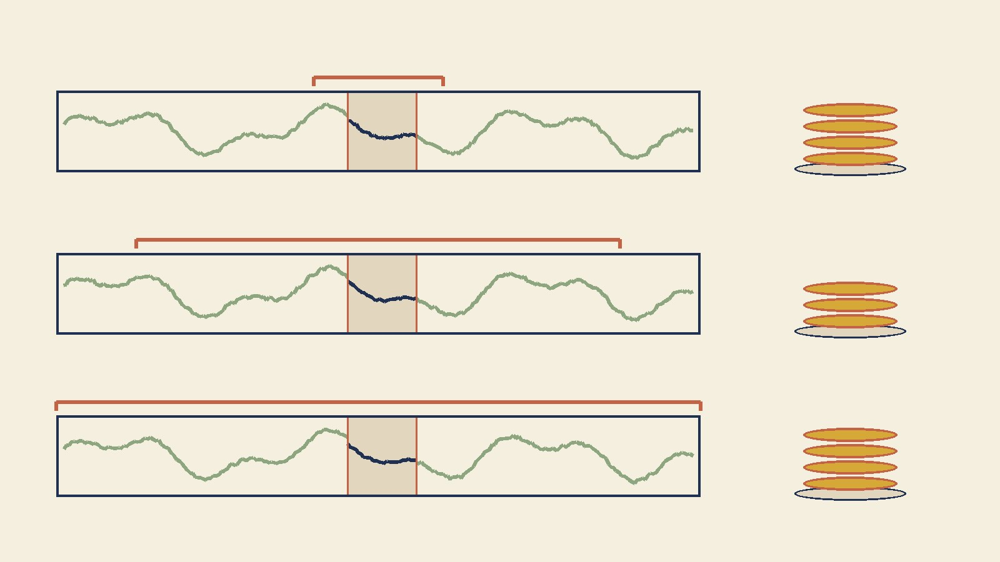

[Last week's post](/posts/cutmix-dose-imu-pass-through/) moved the CutMix dose sweep from CIFAR-10 to the IMU activity classifier and found the same shape at a third of the size: the clean-confidence tax was still proportional to dose, but the model passed through only 13 to 20 percent of its labels' average deflation where the ResNet had passed 27 to 39. I offered an explanation and admitted it was one. The [HAR CNN](/posts/har-augmentation-fifty-splits/) sees 26 of the window's 128 samples per position and averages over time before classifying, so its logit is an average of local verdicts, a spliced segment contributes to that average in proportion to its length whether or not anyone trained it to, and a model that gets proportionality from its pooling has nothing to learn from the soft labels that would spill onto clean windows. The baseline's own numbers fit: it obeyed patches far better than the untrained ResNet did. The post ended by naming the test — swap the average pool for a classifier that sees the whole window, and if the pass-through climbs toward forty the rate belongs to the receptive field. Three-second training runs mean that kind of sentence has a short shelf life. Here is the test, with one extra arm to split the hypothesis in two:

- **avgpool**: the shipped model, receptive field 26 samples, global average over time. Rerun here as the control, same splits as last week.
- **widefield**: the same three conv layers plus three dilated 3-tap layers (dilation 4, 8, 16 at stride 4), receptive field 250 samples, wider than the window — still average-pooled. If the rate rises here, it was the receptive field.
- **flatten**: the shipped convs, but the average pool replaced by a flatten and a linear layer over all 32 positions. Every output weight sees the whole window; nothing is averaged. If the rate rises here but not in widefield, it was the pooling.

Same four doses, 0 / 0.25 / 0.5 / 1, same [1-D CutMix](/posts/cutmix-dose-imu-pass-through/), same fifty paired subject splits with the same fixed patched probe per split, 600 training runs, 43 minutes of GPU with another job sharing the card.

## The rate, three ways

| arch | RF | params | baseline obedience err | baseline conf − acc | clean gap at p = 0.25 / 0.5 / 1 | pass-through at p = 0.25 / 0.5 / 1 |
|---|---|---|---|---|---|---|
| avgpool | 26 | 96k | 21.3 | +2.6 | 1.41 / 2.21 / 3.87 | 19.6 / 15.4 / **13.5%** |
| widefield | 250 | 244k | 24.5 | +3.5 | 1.26 / 2.49 / 3.22 | 17.6 / 17.3 / **11.2%** |
| flatten | 26 → whole window | 120k | 28.7 | +3.8 | 1.97 / 2.65 / 3.51 | 27.4 / 18.4 / **12.2%** |

Paired against avgpool at the full dose, widefield passes through 2.3 points *less* (t = −6.3, 6 of 50 splits higher) and flatten 1.3 points less (t = −4.2, 14 of 50). Nothing climbs toward forty; both arms land under the control. The hypothesis is refuted in both halves. A classifier that sees the entire window at once, with no averaging anywhere between its last conv and its logits, leaks the same eighth of the label discount onto clean windows that the averaging model does. Whatever sets the rate at a third of CIFAR's is not the thing I pointed at.

There is a partial-dose wrinkle worth recording because fifty splits can resolve it. At a quarter dose flatten's rate is 27.4 percent, eight points above avgpool (t = +9.1, 45 of 50), and at half dose three points above; the whole-window classifier's tax is more concave in dose, front-loaded at the low end and converging with the others at the top. It is the only trace of an architecture effect on the leak, and it points the wrong way for the hypothesis: it is the *non*-averaging model that leaks more, and only when CutMix is rare.

## What the architecture does own

The hypothesis was not built on nothing, and the thing it was built on survives. The baseline column — models trained with no CutMix at all — obeys patches in exactly the order the receptive-field story predicts. Untrained obedience error is 21.3 for the averaging model, 24.5 once the receptive field spans the window (t = +33 against avgpool, 50 of 50 splits), and 28.7 for the whole-window classifier (t = +57, 50 of 50), with dominant-class hits falling 83.6 → 82.2 → 77.1 in step. The flatten baseline's 28.7 is within four points of the untrained ResNet's 32.2 on CIFAR. So the free proportionality is real: the small-receptive-field, average-pooled model does get its patch obedience from its structure, and taking the structure away takes the obedience away.

What that result shows, together with the table above, is that untrained obedience and the pass-through rate are two different quantities. The first is set by the architecture. The second is not moved by it. The model that starts out obeying worst (flatten, 28.7) and the model that starts out obeying best (avgpool, 21.3) leak the same fraction of the label discount once trained at full dose. My argument had chained them — "it already obeys, so it has nothing to learn, so nothing spills" — and the chain breaks at the second link: the wide models have a great deal to learn from the soft labels, learn it, and still do not spill more.

## The wide models get more for the same money

Which brings up the result I did not set out to measure. Full-dose CutMix, paired against each architecture's own baseline:

| arch | accuracy Δ | worst-subject Δ | obedience err Δ | dominant hits Δ | clean conf Δ | ECE Δ | full-dose conf − acc |
|---|---|---|---|---|---|---|---|
| avgpool | +0.17 (t = 1.8) | +0.66 (t = 1.5) | −7.9 | +2.1 | −3.9 | −0.28 (t = −0.9) | −1.4 |
| widefield | +0.20 (t = 1.7) | +1.76 (t = 2.7, 35/50) | **−14.8** | +4.3 | −3.2 | −1.24 (t = −4.6) | **+0.1** |
| flatten | **+0.45** (t = 3.2, 34/50) | **+2.44** (t = 3.6, 37/50) | **−14.7** | **+7.1** | −3.5 | −1.50 (t = −4.9) | **−0.2** |

The two wide models learn nearly twice the occlusion skill from the same dose: obedience error falls by 14.8 and 14.7 points against the averaging model's 7.9, taking widefield to 9.7, the best obeyer this blog has trained on any task, and flatten's dominant-class hits climb 7.1 points against avgpool's 2.1. They pay the same or less for it in clean confidence, 3.2 and 3.5 points against 3.9. And because their baselines were more over-confident to begin with (+3.5 and +3.8 against +2.6), the tax lands them within two tenths of a point of honest at the full dose — confidence 93.1 on accuracy 93.0 for widefield, 92.6 on 92.8 for flatten — where last week's averaging model overshot to −1.4. For these two, the full dose is a calibration, not a cost, and the ECE deltas say so at t ≈ −5.

The worst-subject column is the practical one. CutMix did little for the hardest held-out users on the shipped model (+0.66, 27 of 50), which is why last week's post left [rotation](/posts/har-augmentation-fifty-splits/) as the tool for that job. On flatten it is +2.44 with 37 of 50 splits improved, and on widefield +1.76 — both above rotation's +1.55 on the shipped model, though not in the same run and so not a paired comparison. The averaging model, it seems, was not a model CutMix could do much for: it already had the obedience, and the accuracy gain was the small residual. A model that has to *learn* to count evidence by area gets the learning and the calibration as part of the same purchase. The flatten baseline is the worst of the three (−0.29 accuracy against avgpool, t = −2.3, presumably the bigger head fitting its training subjects), and at full dose it is level with the others; CutMix spends its gain on exactly the overfitting that the wider head introduced.

Scope lines: one sensor dataset, three small 1-D models, one budget, three doses of one augmentation, fifty subject splits; the receptive-field arm also adds parameters, so it changes two things, though the flatten arm adds few and its baseline is worse rather than better. What survives: CutMix's pass-through rate on the IMU task is not a property of the receptive field or of the pooling, which leaves the data; the architecture does set how well an untrained model obeys patches, and that is a separate quantity from the leak; and the models that start without free obedience learn twice as much of it from CutMix, for the same tax, and come out calibrated. The next question is the one the refutation leaves standing: whether a third is a property of *this* data — six activities, windows that one segment can turn from one class into another — or of time series generally. The [sampling-rate](/posts/imu-sampling-rate-measured/) and [window-length](/posts/har-window-length-measured/) benches already have the harness to change what a window contains without changing the model, and that is where the rate goes next.
