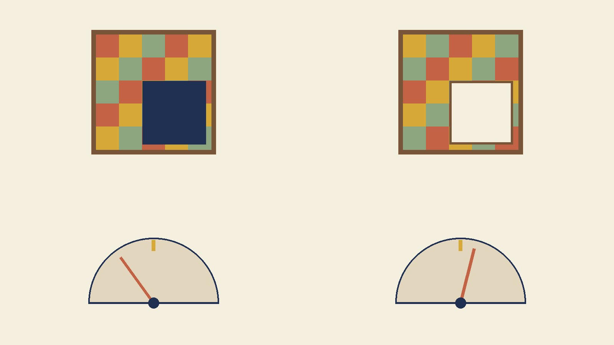

The [decomposition post](/posts/cutout-cutmix-decomposition/) in early November put CutMix's two ingredients on trial separately at a 10-epoch budget. The hole alone, zero-filled with the label left one-hot, cost 4.40 points of accuracy; the hole with its area-proportional soft label cost 3.08; the verdict was that the label was buying back part of the hole's damage, and the calibration panel showed the hard-label models inheriting the baseline's three points of over-confidence exactly, as if nothing had been erased. The arc has moved on since. At [40 epochs](/posts/cutmix-budget-crossover/) CutMix turned its loss into a gain, and the [dose sweep](/posts/cutmix-dose-tax/) read its ten-point confidence shortfall on clean images as a pass-through of what the soft labels withhold on average. That reading makes a clean prediction for the control I never re-ran: a model trained on holes with hard labels has labels that withhold nothing, so it should carry no confidence tax, keep the baseline's over-confidence, and obey patches no better than the baseline because nothing ever asked it to count foreign pixels. Five Cutout models at 40 epochs test that — the exact matched box sampler, `λ ~ Beta(1, 1)`, border clipping, 30% of the image zeroed on average, the [usual recipe](/posts/sgd-vs-adam-fixed-budget/), paired with the 40-epoch baseline and CutMix models [already on disk](/posts/cutmix-patch-obedience-probe/). Every model is scored on two probes drawn from the same fixed boxes: the patched probe the arc has used since the obedience post, where the box is filled from a partner image, and a new hole probe, where the same box is zero-filled and the question is whether confidence in the true class tracks how much of the object survived.

## Three models, two probes

| model | accuracy (paired Δ vs baseline) | clean conf | conf − acc | ECE | patched: obedience err | patched: dominant hits | holes: accuracy | holes: true-class conf | holes: slope vs retained area |
|---|---|---|---|---|---|---|---|---|---|
| baseline | 92.73 | 96.7 | +3.9 | 4.00 | 32.2 | 66.9 | 64.9 | 63.2 | 1.15 |
| CutMix p = 1 | 93.07 (+0.35, t = +4.2, 5/5) | 86.3 | −6.8 | 6.83 | 18.5 | 77.6 | 78.1 | 62.9 | 0.88 |
| **Cutout matched** | 92.30 (**−0.43**, t = −4.4, 0/5) | 94.2 | +1.9 | **1.99** | 28.9 | 71.2 | **84.9** | **79.8** | **0.57** |

Every Cutout-versus-baseline delta in the table has |t| above 4 with five wins or five losses out of five; the seed spread on Cutout's clean confidence is 0.10. Hole-probe accuracy by retained area (under 40% / 40–60 / 60–80 / 80–95 / over 95): baseline 19 / 42 / 67 / 84 / 93; CutMix 29 / 64 / 83 / 90 / 94; Cutout 62 / 80 / 86 / 91 / 94.

## A quarter of the tax, paid toward honesty

The prediction was wrong in its first clause and right in its spirit. The hole does take clean confidence: 2.45 points below the baseline, forty times its standard error, with labels that never asked for anything but 100. So not all of CutMix's 10.4-point gap is label pass-through; about a quarter of it is reproduced by the occlusion alone, which revises the [dose post's](/posts/cutmix-dose-tax/) arithmetic from "the model leaks forty percent of the label discount" to roughly thirty percent leaked plus a fixed hole surcharge. The remaining 7.9 points need the soft label; no amount of erasing produces them.

But the two taxes are not the same kind. The baseline at 40 epochs is over-confident by 3.9 points — 96.7 confidence on 92.7 accuracy, the [same +3 the 10-epoch models carried](/posts/cutout-cutmix-decomposition/), now a little wider. Cutout's 2.45 come off that surplus. It lands at +1.9, half the baseline's over-confidence, and its ECE is 1.99 against the baseline's 4.00 and CutMix's 6.83 — the second-best native calibration of any 40-epoch model in this arc, a hair behind the quarter-dose CutMix's 1.76 and [reached the same way](/posts/cutmix-dose-tax/), by deflating an over-confident model partway toward its accuracy rather than through it. CutMix at full dose goes through: 6.8 points under. The hole's tax is a discount on confidence the model had no right to; the label's tax keeps charging after the model is honest. At 10 epochs the hard-label models showed no deflation at all, so this is a budget effect: the 10-epoch baseline had barely saturated its confidence, and there was nothing yet for the hole's regularization to take back.

## What a hole teaches about patches it never saw

The second clause — no obedience without a soft label — is also wrong, by a measurable fraction. On the patched probe, which fills the box with a *different* image and asks the model to split its confidence by area, Cutout obeys better than the baseline: obedience error 28.9 against 32.2 (t = −18.5), response slope 1.12 against the baseline's over-steep 1.22, dominant-class hits 71.2 against 66.9. Those are a quarter of CutMix's obedience gain and forty percent of its dominant-hit gain, bought by a model that never saw a foreign pixel or a label below one. What the hole teaches is apparently that *the box region is not to be trusted*, and that lesson transfers partway to boxes that contain a second object instead of nothing. It is the same transfer the [obedience probe](/posts/cutmix-patch-obedience-probe/) found in the other direction, where CutMix's discounting generalized to a probe box whose contents it had never seen.

On the hole probe the roles reverse and the picture gets sharper. This is Cutout's home turf, and it owns it: 84.9% accuracy on images with 30% of their area blacked out on average, twenty points over the baseline and seven over CutMix, and 62% accuracy on the images that lost more than sixty percent of their pixels, where the baseline manages 19 and CutMix 29. Its confidence follows its accuracy — 79.8 against 84.9, a few points under, roughly calibrated. CutMix is the interesting failure here: 78.1% right on holed images but 62.9 confident, fifteen points under, and its maximum probability on holes is 70 against the other two models' 86. It learned, correctly by its labels, that missing area means missing confidence, and it applies that discount to holes that contain nothing — honest by the training contract, wrong by the test. The slope column says the same thing numerically: true-class confidence per unit of retained area is 1.15 for the baseline (confidence collapses faster than the object disappears), 0.88 for CutMix (nearly proportional, as trained), and 0.57 for Cutout (confidence held up through the hole, as trained).

## The bill it never stops paying

The accuracy column is the part the budget did not fix. At 10 epochs matched Cutout lost 4.40 points; at 40 it loses 0.43, a tenth of the damage, but still a loss in five of five seeds while CutMix, with the identical hole, gains 0.35. The gap between them is 0.77 points (t = −6.3): what the soft label is worth at this budget, up from 1.31 at the short one. The label stopped merely *repaying* the hole's damage and started turning the same erased pixels into a gain, and the hole on its own never crossed zero. Whether it would at 80 epochs is the natural follow-up and I'd guess not: the damage shrank by a factor of ten across a factor of four in budget, and the [CutMix tax plateaued](/posts/cutmix-80-epoch-tax-plateau/) over the same stretch, so the next doubling has less to work with.

Scope lines: one dataset, one small model, one budget, one hole distribution, five seeds, two probes drawn from the sampler's own boxes. What survives: the hole carries a confidence tax of its own, a quarter of CutMix's, and spends it on removing over-confidence rather than on under-confidence; the soft label owns the other three quarters and the entire crossing of the honest line; a hard-label hole teaches a usable fraction of patch obedience; on real holes Cutout is the only one of the three that is both right and sure, and CutMix's obedience becomes a liability; and the hole without its label loses accuracy at every budget measured, which is the one line of the original verdict that four times the training did not touch.
