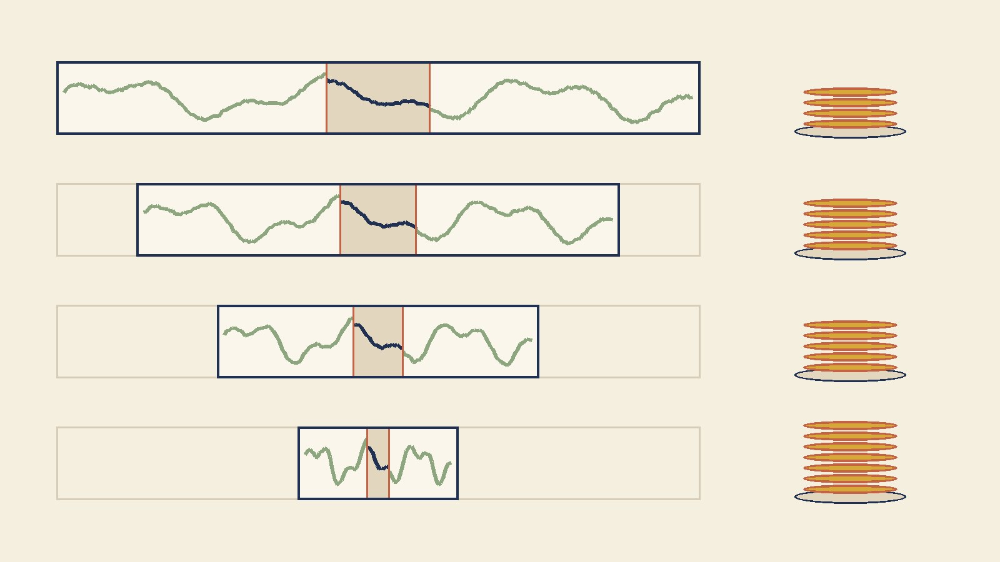

Two posts ago the CutMix dose sweep [crossed to the IMU classifier](/posts/cutmix-dose-imu-pass-through/) and found the confidence tax a third the size it is on CIFAR: the model passed 13 percent of its labels' average deflation through to clean windows where the ResNet passed 39. [Yesterday](/posts/cutmix-pass-through-receptive-field/) I tested the explanation I had offered — that the small 1-D CNN gets proportional obedience for free from its receptive field and its time-average pooling — by removing each in turn, and the rate did not move. That leaves the data, and the post ended by naming the cheapest way to change the data without changing the model: the [window-length harness](/posts/har-window-length-measured/), which centre-crops the 2.56-second windows to 1.92, 1.28 and 0.64 seconds and found in September that the shortest costs under a point of accuracy. So: the same avgpool model, the same fifty paired subject splits, four window lengths, CutMix at p = 0 / 0.5 / 1 on each, 600 training runs in 23 minutes. The 1-D CutMix, the fixed patched probe and the pass-through arithmetic are unchanged from the earlier posts; the spliced segment is a fraction of whatever window it lands in, so the labels' average request is the same 71 to 72 at every length. The only thing that changes is how much signal a window holds.

## Four lengths, three doses

| window | duration | baseline acc (Δ vs 128) | baseline obedience err | clean gap at p = 0.5 / 1 | pass-through at p = 0.5 / 1 | Δ vs 128 at p = 1 |
|---|---|---|---|---|---|---|
| 128 | 2.56 s | 92.62 | 21.3 | 2.20 / 3.85 | 15.3 / **13.4%** | — |
| 96 | 1.92 s | 92.56 (−0.06) | 21.6 | 2.29 / 4.58 | 15.8 / **15.9%** | +2.5 (t = +12.9, 48/50) |
| 64 | 1.28 s | 92.30 (−0.32) | 22.1 | 2.54 / 5.33 | 17.8 / **18.6%** | +5.2 (t = +18.9, 50/50) |
| 32 | 0.64 s | 91.80 (−0.81) | 24.4 | 3.26 / 6.87 | 23.4 / **24.6%** | +11.2 (t = +35.6, 50/50) |

The baseline accuracy deltas reproduce [September's](/posts/har-window-length-measured/) −0.11 / −0.34 / −0.87 to within a tenth, which is the kind of check fifty paired splits make routine. Every clean gap is 0 of 50 splits with |t| above 34. CutMix's accuracy effect is +0.15 to +0.20 at every length (t between 1.5 and 2.0), flat as before.

## The rate moves, and it moves with the data

Shortening the window from 2.56 to 0.64 seconds takes the full-dose pass-through from 13.4 to 24.6 percent — the tax nearly doubles, 3.85 to 6.87 points, while the labels withhold exactly as much as before and the baseline gives up 0.8 points of accuracy. The climb is monotonic and every step is resolved: +2.5 at 96 samples, +5.2 at 64, +11.2 at 32, the last two in fifty of fifty splits. The half dose follows the same curve within two points, so the tax stays proportional to dose at every length and only its slope changes. After two posts in which nothing I changed moved the rate, the first change to the input's content moves it by a factor of nearly two.

What changed is not the request, not the model, and not — to any useful degree — the untrained obedience. The baseline's obedience error drifts from 21.3 to 24.4 across the four lengths, a three-point change against the eleven-point change in pass-through, and yesterday showed those two quantities decoupled anyway. What changed is how much of each window is *spare*. A 2.56-second window at 50 Hz holds two to three gait cycles; a classifier that has learned to discount a patched region can afford to, because a clean window carries the same evidence two or three times over and the discount has somewhere else to be recovered from. At 0.64 seconds a window holds well under one cycle. There is no redundant copy of the evidence, so whatever discounting the soft labels taught has nowhere to hide and shows up on clean inputs as a lower number. The rate, on this reading, measures how far the model's trained-in discount can be absorbed by evidence it does not need — and that is a property of what a window contains, which is what the two negative results were pointing at by elimination.

It also says something about why the image model leaks three times as much. A 32-by-32 CIFAR image is the opposite of a redundant window: the object fills it, every patch of it carries evidence that nothing else in the image duplicates, and the dose post's CutMix sampler takes about thirty percent of that. On this scale the image model sits past the short end of the IMU curve — 24.6 percent at a window that is already a fraction of a gait cycle, 39 on an input with no spare evidence at all — and the ordering is the one the redundancy story predicts.

## What it costs at the short end

The practical column is calibration, and it runs the same direction. The baseline's over-confidence grows slightly as the window shrinks (+2.6 to +3.0 points), but the full-dose tax grows faster, so the over-shoot past honest gets worse: −1.4 at 128 samples, −2.1 at 96, −2.7 at 64, −4.0 at 32, with ECE following from 3.7 to 5.2. The half dose stays near the honest line at every length, ECE 3.2 to 3.4 against baselines of 4.1 to 4.5, and is the only full-table setting that improves calibration everywhere. If you deploy [short windows](/posts/har-window-length-measured/) to cut latency, CutMix's dial has to come down with them: the half dose is the setting the data picks at every length, and the full dose at 0.64 seconds is four points under-confident on clean input for a two-point gain in dominant-class hits. The occlusion skill itself scales the other way — the full dose buys 3.8 points of dominant-class hits at 32 samples against 2.1 at 128 — so the short window is where CutMix teaches the most and charges the most, in the same proportion.

Scope lines: one sensor dataset, one small model, one budget, two doses of one augmentation, four centre-crops of one window, fifty subject splits with their usual spread. What survives: CutMix's confidence pass-through is a property of the input's content, not of the architecture — the first thing in three posts that moved it, moved it nearly twofold; the rate tracks how much of a window is spare, which puts the image model's 39 percent at the non-redundant end of the same curve; and short windows pay more tax per unit of dose, so the dial that was indifferent at 2.56 seconds matters at 0.64. The redundancy reading makes two predictions I can test. On the signal side, a 16-sample window, 0.32 seconds, should pass through more than thirty percent. On the image side, a CIFAR image tiled twice into a 64-by-64 mosaic gives the ResNet a duplicate of every patch of evidence, and if redundancy is the mechanism its pass-through should fall from 39 toward the IMU model's range. The first is a three-second run per model; the second is an afternoon of GPU; both are on the list.
